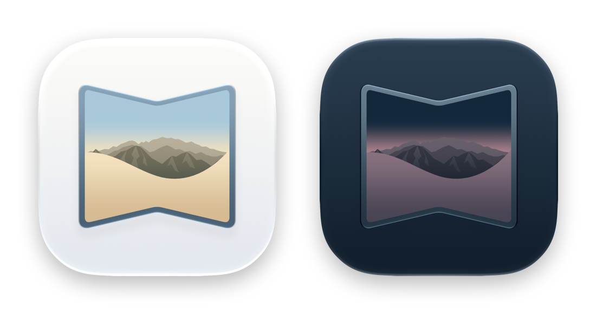
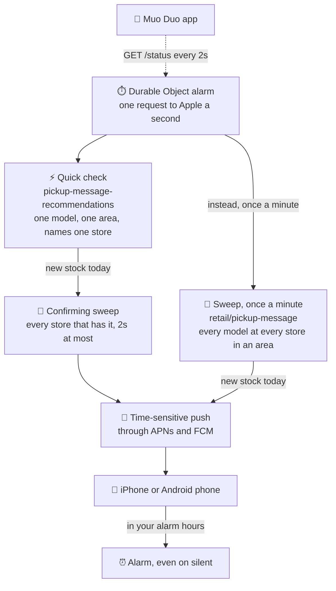

<p align="center">
  
</p>

<h1 align="center">Muo Duo</h1>

<p align="center">
  <strong>Know the moment an iPhone Duo is ready to collect.</strong><br>
  Real-time stock alerts for Apple Store pickup in the UK, and an alarm to wake you when it lands first thing.
</p>

<p align="center">
  
  
  
  
  
  
  
</p>

---

The iPhone Duo is rare, and when Apple restocks it, it sells out almost instantly. Muo Duo watches 20 Apple Stores across London, the south of England and Manchester, asking Apple once a second. The moment one is available to collect **today**, your iPhone gets an alert that breaks through Focus, and one tap opens it in the Apple Store app. Restocks tend to land first thing, so in the hours you choose it rings an alarm too, even on silent.

It comes in three parts:

| | |
| --- | --- |
| ☁️ **[`worker/`](worker)** | A Cloudflare Worker with one Durable Object. It does all the checking, polling two of Apple's pickup endpoints one request a second, and sends the pushes, through APNs to iPhones and Firebase Cloud Messaging to Android phones. |
| 📱 **[`ios/`](ios)** | A SwiftUI app with a Liquid Glass design. It shows the checker working live, where and when an iPhone Duo was last in stock, a map of the stores, and which models alert you. |
| 🤖 **[`android/`](android)** | The same app for Android 12 and later, in Kotlin with Jetpack Compose: the same screens, and the same glass over the same sky. |

## Features

<table>
<tr>
<td width="50%" valign="top">

**⚡ Fast**<br>
Apple is asked once a second, so each model is checked in each area about every 12 seconds. New stock is spotted about 6 seconds after it appears, on average, and pushed straight away.

</td>
<td width="50%" valign="top">

**🔔 Alerts that get through**<br>
Time-sensitive pushes break through Focus and say where the stock is. Tapping one opens the model in the Apple Store app, already chosen, ready to buy.

</td>
</tr>
<tr>
<td valign="top">

**⏰ An alarm for first thing**<br>
Stock found in your alarm hours rings a real alarm, through silent mode and Focus, like the Clock app's. The hours start at 06:00–08:00; tap them in Settings to choose your own.

</td>
<td valign="top">

**🎯 Only what you can collect**<br>
Only stock Apple quotes as "Available Today" counts, so you're never woken for something you can't pick up. Choose which sizes and colours you hear about.

</td>
</tr>
<tr>
<td valign="top">

**🗺️ 20 stores, 3 areas**<br>
London, the south of England and Manchester, on a map. Once a minute, one area is swept for every store that has stock, not just the nearest.

</td>
<td valign="top">

**📡 Watch it work**<br>
Every check pulses: rings spread out from the phone, the area's pins ripple on the map, and the bar along the bottom names what was just checked. Tap it for a full-screen live view.

</td>
</tr>
<tr>
<td valign="top">

**📖 Stock log**<br>
Where each model came into stock, at which store, and how long it lasted, grouped by day, so a night's stock can be read back over breakfast.

</td>
<td valign="top">

**🛡️ Honest about problems**<br>
LIVE only ever means live. If Apple stops answering or results look stale, the app says so and you get a push, so silence never passes for "no stock".

</td>
</tr>
<tr>
<td valign="top">

**🤝 Fair to Apple**<br>
One request at a time, never more than one a second. When Apple pushes back, Muo Duo slows down, and it never tries to get around Apple's bot shield.

</td>
<td valign="top">

**✨ Liquid Glass**<br>
Glass cards over a slowly drifting sky that takes the look of the colour you pick: a dusk desert with stars for Night Sky, the same desert at dawn for Star White.

</td>
</tr>
</table>

## How it works



The Worker takes turns through 12 quick questions, 4 models in each of 3 areas, one a second. When one finds new stock, its area is swept so the alert can name every store that has it, then the push goes out. The app does no checking of its own: it watches the Worker.

### Where it looks

One search only reaches Apple's 12 nearest stores, so the checker runs three:

| Area | Search | Stores |
| --- | --- | --- |
| 🏙️ London | `NW6 5PU` | all 12 in and around London, Watford to Bluewater |
| 🌊 South of England | `DT1 1XJ` | Brighton, Basingstoke, Reading, Southampton, Bath, Bristol |
| 🐝 Manchester | `Manchester` | Arndale and Trafford Centre |

Each area lists its store numbers, and answers are filtered to them, so a far-off store Apple adds to an answer is ignored. If Apple leaves a listed store out, the store shows as "not covered" in the app. Milton Keynes and Cambridge are just outside these searches; add another area to cover them.

<details>
<summary><strong>The details: endpoints, sweeps, alarms, health checks and costs</strong></summary>

<br>

- **Endpoints.** Apple's `fulfillment-messages` endpoint sits behind a bot shield (HTTP 541 without a browser session), so it isn't used. Two others are open:
  - `pickup-message-recommendations` is quick and does most of the checking. For the part asked about, it lists the *other* colours at the same capacity that are in stock near the search; the queried part itself never appears. So the checker queries every colour at each watched capacity and keeps any watched part that comes back. It only ever names one store with stock, however many have it.
  - `retail/pickup-message` answers for every watched part at all 12 stores nearest the search in one go, so it finds every store with stock. It's slower, and Apple is warier of it: it sometimes answers with the 541 bot shield. So it's asked less often, in a sweep.
- **Sweeps.** Once a minute an alarm sweeps one area instead of asking its quick query, taking turns, so each area is swept every 3 minutes. Sweeping every 5 minutes instead was tried: Apple's bot shield (541) still turned sweeps away in waves of about an hour, and fewer of them got through. And when a quick check finds new stock, its area is swept before the push goes out, so the alert names every store that has it. That sweep gets 2 seconds; if Apple's slower, the alert goes without it. Stock is the quick checks' latest answers plus each area's last sweep. A sweep stops counting after 5 minutes, and when a quick check finds none of a capacity's other colours anywhere near an area, what the area's last sweep found of them goes straight away. Neither source can cancel stock the other has found, so a disagreement errs towards alerting.
- **Today only.** Only stock Apple quotes as "Available Today" is alerted on or logged. Once the stores close, Apple quotes everything for tomorrow, so in the evening nothing counts until the next day.
- **Alarm hours.** Restocks tend to land first thing, so the hours start as 06:00 to 08:00 UK time, and each phone can change its own in Settings. Stock found in those hours also rings an alarm: the push goes through the app's notification service extension, which schedules an [AlarmKit](https://developer.apple.com/documentation/alarmkit) alarm a second later, sounding through silent mode and Focus like the Clock app's. Only one rings at a time. If it can't ring, the notification says why. Apple doesn't document scheduling alarms from a notification service extension, so test it from Settings.
- **Postcodes, not towns.** Apple's search takes town names too, but not reliably: "Manchester" and "Exeter" work, "Brighton" returns no stores, "Brighton and Hove" is rejected, and "Dorchester" picks Dorchester-on-Thames in Oxfordshire. `PUT /config` test-runs every new search against Apple and refuses one that fails or misses any of its listed stores.
- **One request at a time, alert straight away.** Each alarm asks one query, whichever was asked longest ago, and pushes as soon as the answer shows stock. Requests are spaced at least a second apart (`MIN_SECONDS_BETWEEN_REQUESTS`), so with 12 queries each one comes round every 12s, even with `intervalSeconds` at its 10s minimum. Stock is spotted ~6s after it appears on average.
- **Alerts fire once per part@store.** A sighting is only remembered after a push was delivered, so a failed push retries on the next cycle.
- **Each phone its own.** Every install of the app makes up an id and sends it as `x-device-id`. Each phone picks its own models, areas and alarm hours, and can mute itself. Apple is asked about whatever any phone wants, and each phone hears only about its own models in its own areas, ringing in its own hours. So more models watched across phones means each one comes round less often. A muted phone still shows stock in the app but gets no pushes, apart from tests. Phones registered by an app from before this follow the config's `parts` and `alarm`, and start from them the first time they register with an id.
- **A friend's key.** An optional second key, `FRIEND_API_TOKEN`, is for a friend's build of the app. It can see the status, register its phone, change that phone's settings and send it a test. Pausing, the areas and `POST /check` stay with `API_TOKEN`, and every request but `GET /status` must send `x-device-id`.
- **Last seen.** Every sighting is kept as a stretch of time a model was in stock at a store. Sightings less than 5 minutes apart join one stretch. The latest 20 are in `/status` as `lastSeen`, alongside `trackingSince`, so the app can say "Not yet" honestly.
- **Stock log.** Each time a watched model comes into stock at a store, or goes again, it's logged with the store, Apple's pickup quote and how long it lasted, alongside the checker's own events: Apple failing and recovering, results looking stale and right again, and pauses. The latest 200 entries are in `/status` as `log`, newest first, with `loggingSince`. A model or store that's no longer watched drops out without being logged as gone.
- **Silence is not "no stock".** After 3 failed checks in a row you get a "Stock checker is failing" push, and a "recovered" push when it comes back. Failures back off exponentially on top of the normal pace, capped at 15 minutes. A response with no stores at all counts as a failure.
- **A canary for empty answers.** Every 10 minutes the checker also asks about iPhone 17 256GB in the first area, where it's reliably in stock. If it shows nothing 3 times running, Apple may be serving empty results, so you get a "Stock results may be stale" push and the app says so.
- **A watchdog.** A cron every 5 minutes restarts the alarm loop if it ever stops.
- **Rate limits.** Apple sends no rate-limit headers and the real ceiling is unknown. Its answers aren't cached (`cdn-cache; desc=MISS`, a new ETag every time), so polling faster really does see changes sooner. Sweeps keep their own pace, and the quick checks carry on as they were whatever happens to them. Apple's bot shield often turns one sweep away and answers another soon after, so a 541 rests only that area, for 5 minutes, then 10, 20 and 30 if it keeps happening, while the other areas keep their turns. Once every area has been turned away with no answer in between, or Apple says 403 or 429, every sweep stops for 5 minutes, then 10, 20 and 30. If Apple sends a `Retry-After`, sweeps wait at least that long, up to an hour. A failed sweep is never retried straight away. `/status` lists any resting areas under `sweep.resting`, and the latest 60 sweeps under `sweep.recent`, to show how often Apple answers them. If Apple pushes back on a quick check (HTTP 403, 429 or the 541 bot shield), the checker halves its speed. A 503 is usually a passing hiccup, so it only counts when the check before it failed too; a lone failure just delays the next request by a second. After every 2 minutes without pushback the speed doubles again, back up to the configured speed. Pushback that keeps coming keeps halving it, down to checking each query every 15 minutes. A single slow-down sorts itself out without a push; a second in a row pushes "Checking less often", and then "Back to full speed" once it recovers.
- **Cloudflare cost.** This needs the Workers Paid plan. Every alarm is a Durable Object request and writes a few storage rows. At one alarm a second that's about 2.6M requests a month, 1.6M over the 1M included, so roughly $0.24 a month, and around 8M row writes, inside the 50M included. Duration can't exceed what's included: one object in memory all month is about 330,000 GB-s of the 400,000.

</details>

<details>
<summary><strong>The app, screen by screen</strong></summary>

<br>

The Worker does all the checking; the app only watches it, polling `/status` every 2 seconds while it's on screen.

- **Live.** The Worker's last 30 requests to Apple are in `/status`. The app replays new ones at the pace they happened, so every check pulses: rings spread out from behind the phone, the toolbar badge ripples, the area's pins ripple on the map, and the ticker along the bottom names the area and model just checked, or "Every store" for a sweep. Tapping the ticker zooms it into a full-screen live view: each area and when it was last asked, Apple's average response time, and the latest requests to Apple as they happen.
- **Stock log.** The home screen shows the latest of the Worker's log, grouped by day: where each model came into stock, at which store, and when it went again, so a night's stock can be read back in the morning. It updates as the app polls, and Show All opens the whole log a day at a time.
- **In stock.** When anything is in stock, a green card appears straight under the colour picker: the capacity and colour, each store that has it and how long it's been there, and a Buy button. Apple's product pages are universal links for the Apple Store app, so Buy opens the model there, already chosen; pick the store for pickup at checkout, since no link can choose it for you. Safari is the fallback if the app isn't installed.
- **Product images.** The hero shows Apple's own product shot for the selected colour, and the whole app takes that colour's look: Night Sky is the dusk desert from its wallpaper, with stars, Star White the dawn one. The images load from Apple's CDN at runtime and are cached on the device; they aren't in this repo.
- **Liquid Glass.** Cards, colour and capacity pickers, the ticker, the toolbar and the full-screen store map's chips and store panel are all glass over a slowly drifting mesh-gradient sky.
- **Status badge.** The badge in the top left says LIVE only while the app can reach the Worker and the Worker is checking Apple. Otherwise it inverts into a solid pill saying what's wrong: OFFLINE (the app can't reach the Worker), PAUSED, FAILING (Apple isn't answering), STOPPED (the Worker's next check is over 2 minutes overdue) or STALE. A slow-down still counts as live, since checks are getting through.
- **Warnings.** If the checker can't reach Apple or the results look stale, a banner says so at the top, since alerts may not arrive. A slow-down after Apple pushes back is less urgent, so it sits at the bottom.
- **Settings** is its own page, pushed from the gear, in the same glass over the same sky. Everything on it is this phone's own, apart from pausing, which stops checks for every phone and needs the owner's key. Alerts come first: every size of both colours, showing which ones this phone will hear about. Turning one on is a tap, but turning one off asks first, so a stray tap can't quietly stop alerts for a size. Pausing checks, muting the phone and turning off an area ask first too. Then the alarm: whether stock rings one and in which hours (tapping the hours opens wheels to choose from and to, in whole UK hours, saved once they stop turning), whether alarms are allowed, and a test alarm sent 10 seconds later, so there's time to lock the phone. Below that are the current pace and last good check, notification registration, a switch to mute this phone and a test push, and each area, ticked if this phone hears about it, which opens to show its stores. Until the phone has registered, its alerts and alarm wait.

</details>

## Run your own

> [!NOTE]
> You'll need an Apple Developer account (push notifications and alarms need a real iPhone and signing), a Cloudflare account on the Workers Paid plan, [Bun](https://bun.sh) and [XcodeGen](https://github.com/yonaskolb/XcodeGen). The Android app also needs a free Firebase project.

### 1. 🔑 APNs key

In [Certificates, Identifiers & Profiles → Keys](https://developer.apple.com/account/resources/authkeys/list), create a key with **Apple Push Notifications service (APNs)** enabled. Download the `.p8` and note its Key ID. Keep the `.p8` out of this repo (`*.p8` is gitignored).

### 2. 🔥 Firebase project

Only for the Android app. In the [Firebase console](https://console.firebase.google.com/), create a project and add an Android app to it with the package name `com.barclayd.muoduo`. Download the `google-services.json` it offers: the app takes four values from it in step 5.

Then in **Project settings → Service accounts**, choose **Generate new private key**. The Worker sends through Firebase with this key. Keep it out of this repo (`*firebase-adminsdk*.json` is gitignored), and delete it once it's in the Worker.

### 3. ☁️ Worker

```sh
cd worker
bun install
bunx wrangler secret put APNS_KEY < ~/Downloads/AuthKey_XXXXXXXXXX.p8
bunx wrangler secret put APNS_KEY_ID          # the 10-character Key ID
openssl rand -hex 32 | tee /dev/tty | bunx wrangler secret put API_TOKEN   # keep this for the app
bunx wrangler secret put FCM_SERVICE_ACCOUNT < ~/Downloads/<project>-firebase-adminsdk-<id>.json   # for Android
openssl rand -hex 32 | tee /dev/tty | bunx wrangler secret put FRIEND_API_TOKEN   # optional, for a friend's build
bunx wrangler deploy
```

Polling starts within 5 minutes of deploying (the cron starts the loop), or immediately once the app registers. Then confirm Apple answers from Cloudflare:

```sh
TOKEN=...   # the API_TOKEN from above
curl -s -X POST -H "Authorization: Bearer $TOKEN" https://muo-duo.barclaysd.workers.dev/check | jq .health
```

`consecutiveFailures: 0` and a `lastSuccessAt` mean it's working. Follow live logs with `bunx wrangler tail`.

### 4. 📱 iOS app

```sh
cd ios
cp Config/Secrets.example.xcconfig Config/Secrets.xcconfig   # paste the API_TOKEN in
xcodegen generate
open MuoDuo.xcodeproj
```

Run it on your iPhone, allow notifications, then use **Settings → Send test notification**. If iOS asks, allow **Time Sensitive** notifications so alerts break through Focus modes, and allow alarms. Then use **Settings → Test Alarm** and lock the phone.

For a friend's iPhone, put the `FRIEND_API_TOKEN` in place of yours.

### 5. 🤖 Android app

You'll need JDK 21 and the Android SDK. [Android Studio](https://developer.android.com/studio) brings both, or without it:

```sh
brew install openjdk@21
brew install --cask android-commandlinetools
sdkmanager "platform-tools" "platforms;android-37.0" "build-tools;37.0.0"
```

Then build it and install it on your phone over USB, with [USB debugging](https://developer.android.com/studio/debug/dev-options#Enable-debugging) on:

```sh
cd android
cp secrets.example.properties secrets.properties   # paste the API_TOKEN and Firebase values in
./gradlew assembleRelease
adb install app/build/outputs/apk/release/app-release.apk
```

The Firebase values are in `google-services.json`: `project_id`, `mobilesdk_app_id`, `current_key` (the API key) and `project_number` (the sender ID). The app reads them from `secrets.properties` rather than the file, so they stay out of the repo.

The release build is signed with your machine's debug key, which is enough to install it yourself. Allow notifications when it asks, then use **Settings → Send test notification**.

For a friend's phone, copy `secrets.properties` to `secrets.friend.properties` (also gitignored), put the `FRIEND_API_TOKEN` in its `MUODUO_API_TOKEN`, and build with `./gradlew assembleRelease -Psecrets=secrets.friend.properties`. Their phone chooses its own settings and can't pause checking. The key is inside the APK, so share it privately rather than posting it anywhere. Firebase App Distribution does this: it emails them an invite, and they install the app through its App Tester app.

```sh
npx firebase-tools login
npx firebase-tools appdistribution:distribute app/build/outputs/apk/release/app-release.apk \
  --app <FIREBASE_APP_ID> --testers friend@example.com --release-notes "What's new"
```

A new version needs a higher `versionCode` in `app/build.gradle.kts`. Build it on the same machine as before: the APK is signed with that machine's debug key, and Android won't install an update signed with a different key.

Android has no AlarmKit, so the alarm is a notification on its own channel that rings on the alarm volume until it's stopped, and takes over the lock screen as the Clock app's alarm does. Do Not Disturb lets it through, unless you've turned off alarms there. Android 14 and later can turn off an app's full-screen alerts; if it has, **Settings** in the app says so and opens the switch. Plain stock alerts don't break through Do Not Disturb on their own: to let them, add Muo Duo to its exceptions.

## API

All routes need `Authorization: Bearer <API_TOKEN>`, or `<FRIEND_API_TOKEN>` for all but `PUT /config` and `POST /check`. The app also sends `x-device-id: <uuid>`, its own id, which the friend's key can't do without outside `GET /status`.

| Route | What it does |
| --- | --- |
| `GET /status` | Config, health, pace, sweeps, current sightings, areas with their stores (name, city, coordinates, covered), `lastSeen`, `trackingSince`, `log`, `loggingSince`, `recentChecks`, device count, next check time, models with product and image URLs. `device` is the asking phone's own settings (`null` until it registers with an id), and sightings, `lastSeen` and `log` are cut to its models and areas. `role` is `owner` or `friend`. |
| `POST /devices` | From the iPhone, `{ "token": "<hex>", "environment": "sandbox" \| "production" }`. From Android, `{ "token": "<FCM token>", "platform": "android" }`. A phone registering again keeps its settings. |
| `PUT /device` | This phone's settings, any of `{ "parts": [...], "alarm": { "enabled": bool, "from": 0–24, "to": 0–24 }, "areas": ["<search>", ...], "muted": bool }`. `areas` are the searches it wants alerts for. Alarm hours are UK time, from included, to not. |
| `PUT /config` | Any of `{ "parts": [...], "areas": [{ "name", "search", "stores": ["R092", ...] }], "intervalSeconds": 10–3600, "paused": bool, "alarm": { ... } }`. Up to 6 areas of up to 12 stores each; new searches are checked against Apple first. `parts` and `alarm` are for phones registered by an app from before each had its own. |
| `POST /check` | Run a check now and return the status |
| `POST /test-notification` | Push a test alert to this phone, or with no `x-device-id`, every registered device. `{ "alarm": true }` rings an alarm too; `"delaySeconds": 0–20` sends it that much later. |

## Development

```sh
cd worker
bun test
bun run typecheck   # regenerates worker-configuration.d.ts first
bunx wrangler dev   # needs API_TOKEN in worker/.dev.vars
```

```sh
cd android
./gradlew assembleDebug   # or installDebug, to a phone or emulator
```

Under `wrangler dev`, Apple answers the local runtime's requests with HTTP 403, though plain `curl` from the same machine gets 200. The deployed Worker isn't affected, so test real checks against the deployment.

The app icon is an [Icon Composer](https://developer.apple.com/icon-composer/) file, `ios/MuoDuo/AppIcon.icon`. To redraw `docs/app-icon.png` after changing it, export both looks with the `ictool` inside Icon Composer:

```sh
ICTOOL="/Applications/Xcode.app/Contents/Applications/Icon Composer.app/Contents/Executables/ictool"
for look in Default Dark; do
  "$ICTOOL" ios/MuoDuo/AppIcon.icon --export-image --output-file "$look.png" \
    --platform iOS --rendition "$look" --width 1024 --height 1024 --scale 1
done
```
